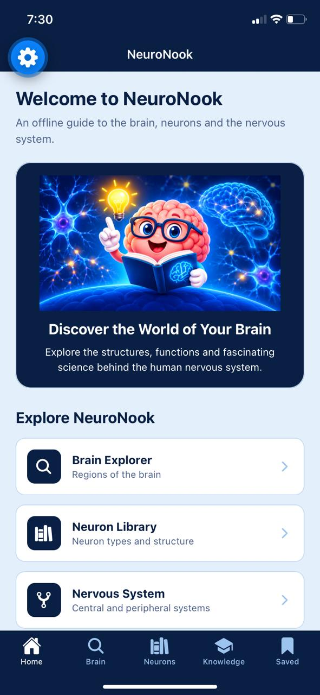
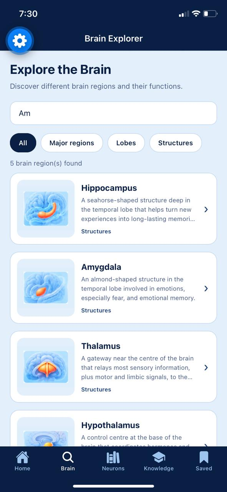
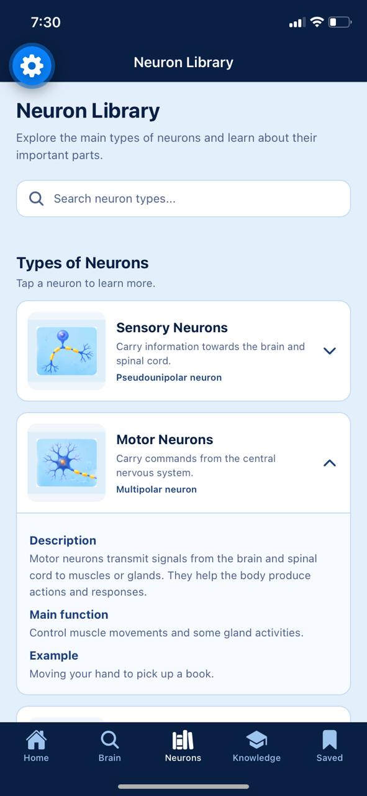
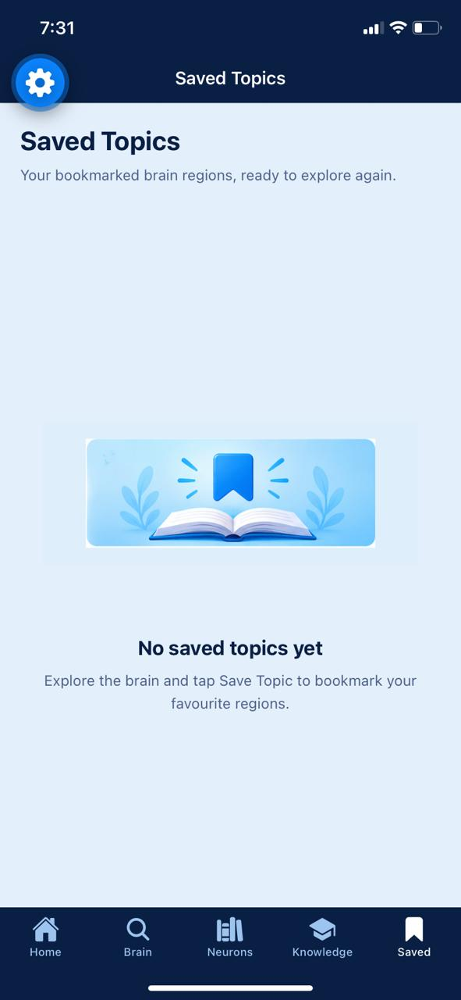
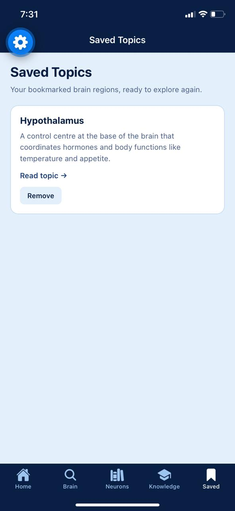

# 🧠 NeuroNook

### Explore the Brain. Understand the Mind.

NeuroNook is an offline-first neuroscience learning application designed to make learning about the human brain and nervous system simple, interactive and engaging.

The application provides educational content, illustrated learning materials, interactive quizzes and saved topics to help users explore neuroscience at their own pace.

---

## ✨ Features

### 🏠 Home

- Welcoming home screen with custom NeuroNook branding.
- Easy navigation to the main learning sections.

### 🧩 Brain Explorer

- Explore different regions of the human brain.
- Search and filter brain regions.
- View detailed information about each region.
- Save interesting topics for later.

### 🧠 Neuron Library

- Explore different types of neurons.
- Learn about neuron structures and their functions.
- View neuroscience illustrations.

### ⚡ Nervous System

- Learn about the central and peripheral nervous systems.
- Explore the somatic and autonomic nervous systems.
- Understand sympathetic and parasympathetic divisions.

### 🩺 Neurological Conditions

- Explore educational information about neurological conditions.
- Learn about their characteristics and symptoms.

### 📚 Knowledge Hub

- Access neuroscience learning resources.
- Explore Learning & Memory.
- Learn about Neurotransmission.
- Test your knowledge through interactive quizzes.

### 📝 Interactive Quizzes

- Multiple-choice questions.
- Instant answer feedback.
- Explanations for answers.
- Score tracking and retry functionality.

### ⭐ Saved Topics

- Save interesting brain topics.
- Access saved topics whenever needed.
- Remove saved topics.
- Persistent storage using SQLite.

### 📡 Offline-First Experience

- Core learning features work without an internet connection.
- Uses bundled local images and educational content.
- Stores saved topics locally using SQLite.

---


## 📱 Application Screenshots

Explore the NeuroNook application through the screenshots below.

<table>
  <tr>
    <td align="center">
      <strong>Home</strong><br/>
      
    </td>
    <td align="center">
      <strong>Brain Explorer</strong><br/>
      
    </td>
  </tr>
  <tr>
    <td align="center">
      <strong>Neuron Library</strong><br/>
      
    </td>
    <td align="center">
      <strong>Knowledge Hub</strong><br/>
      
    </td>
  </tr>
  <tr>
    <td align="center">
      <strong>Saved Topics</strong><br/>
      
    </td>
    <td align="center">
      <strong>Saved Topics — Additional View</strong><br/>
      
    </td>
  </tr>
</table>


## 🛠️ Technologies Used

| Technology   | Purpose                             |
| ------------ | ----------------------------------- |
| React Native | Mobile application development      |
| Expo         | Development and application tooling |
| JavaScript   | Application programming             |
| Expo Router  | Navigation and routing              |
| SQLite       | Local database storage              |
| Ionicons     | Interface icons                     |
| Git & GitHub | Version control                     |

---

## 📂 Project Structure

```text
NeuroNook/
│
├── app/
│   ├── (tabs)/
│   │   ├── index.jsx
│   │   ├── brain-explorer.jsx
│   │   ├── neuron-library.jsx
│   │   ├── knowledge-hub.jsx
│   │   └── saved-topics.jsx
│   │
│   ├── brain-knowledge-quiz.jsx
│   ├── learning-memory.jsx
│   ├── neurotransmission.jsx
│   ├── nervous-system.jsx
│   ├── neurological-conditions.jsx
│   └── topic-detail.jsx
│
├── assets/
│   ├── brain-regions/
│   ├── home/
│   ├── knowledge-hub/
│   ├── neurons/
│   ├── nervous-system/
│   └── saved-topics/
│
├── components/
├── constants/
├── database/
├── data/
│
├── app.json
├── package.json
└── README.md
```

---

## 🚀 Getting Started

### Prerequisites

Make sure you have installed:

- Node.js
- npm
- Expo Go (if testing on a mobile device)

### 1. Clone the repository

```bash
git clone https://github.com/Yazhiny-Manivannan/NeuroNook.git
```

### 2. Navigate to the project directory

```bash
cd NeuroNook
```

### 3. Install dependencies

```bash
npm install
```

### 4. Start the Expo development server

```bash
npx expo start
```

### 5. Run the application

- Scan the QR code using Expo Go on your mobile device.
- Alternatively, use the available development options to run the application on a supported platform.

---

## 💾 Offline Functionality

NeuroNook follows an offline-first approach.

Its core educational content and illustrations are bundled locally, while SQLite provides local storage for saved topics.

An internet connection is not required for the core learning experience.

---

## 🎨 Design

NeuroNook uses a clean neuroscience-inspired visual design featuring:

- Navy blue
- Light blue
- White
- Custom neuroscience illustrations
- Simple and user-friendly navigation

---

## 🌱 Project Status

**Development Phase Completed**

The main application features have been implemented and tested. The completed development branch has been merged into the `main` branch.

Future improvements may include additional neuroscience topics, learning activities and application release builds.

---

## 👩‍💻 Repository

**GitHub:**
[https://github.com/Yazhiny-Manivannan/NeuroNook](https://github.com/Yazhiny-Manivannan/NeuroNook)

---

*NeuroNook — Learn. Explore. Understand.* 🧠
